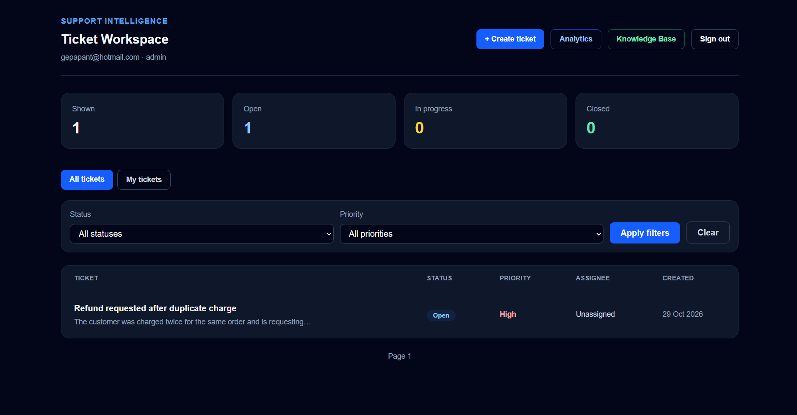
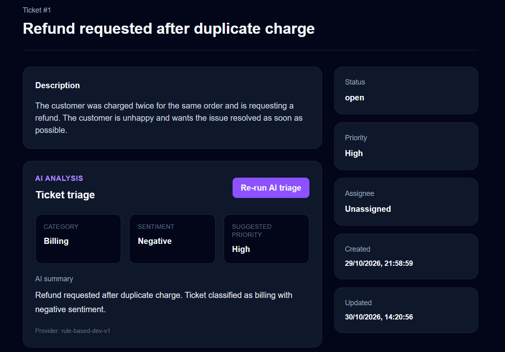
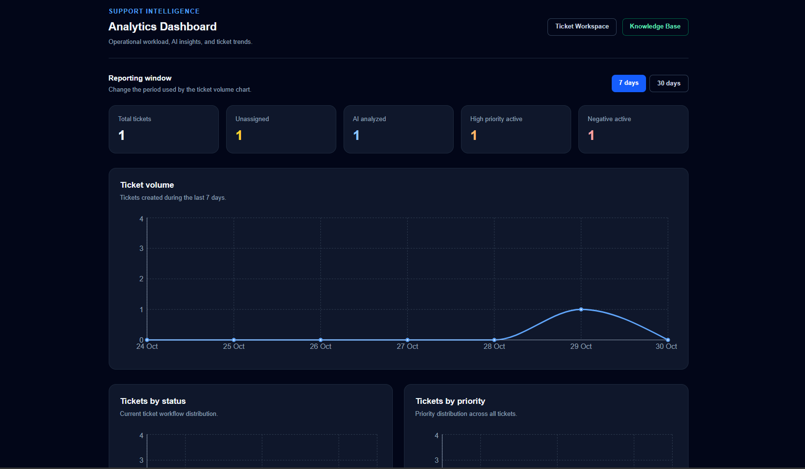
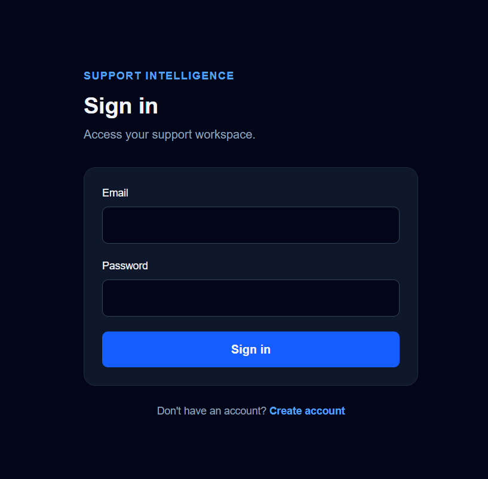
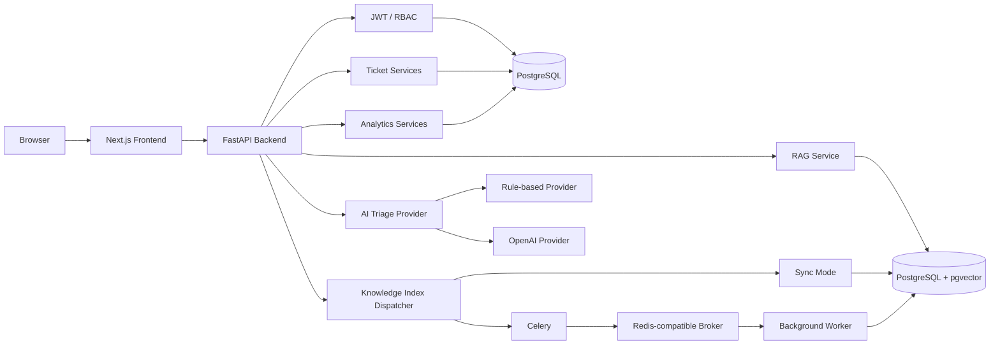

# Support Intelligence Platform

A production-style full-stack customer support platform combining ticket operations, role-based workflows, AI-assisted triage, knowledge retrieval, human-reviewed reply assistance, operational analytics, and resilient backend architecture.

Built as a software engineering portfolio project with a focus on backend design, authentication and authorization, testing, AI integration patterns, asynchronous processing, database architecture, and a modern TypeScript frontend.

---

## Live Demo

- **Live Application:** https://support-intelligence-platform-one.vercel.app
- **API Documentation:** https://support-intelligence-api-s5jr.onrender.com/docs
- **Source Code:** https://github.com/gepapant/support-intelligence-platform

The public demo uses:

- Next.js on Vercel
- FastAPI on Render
- PostgreSQL on Render

> The backend runs on free-tier infrastructure, so the first request after inactivity may require a cold start.

---

## Screenshots

### Ticket Workspace



### AI-Assisted Ticket Triage



### Analytics Dashboard



### Landing Page



---

## Overview

Support Intelligence Platform models a realistic customer-support workflow.

Users can create accounts and authenticate securely, while support agents and administrators can work with tickets through role-based workflows.

The platform supports:

- User registration and authentication
- Agent and admin roles
- JWT-based authentication
- Role-based access control
- Ticket creation and management
- Ticket assignment
- Ticket status workflows
- Filtering and pagination
- AI-assisted ticket triage
- Knowledge Base management
- Vector-oriented retrieval architecture
- RAG-style reply assistance
- Human review and audit workflow
- Knowledge indexing
- Queue failure recovery
- Operational analytics
- Backend and frontend CI

---

# Main Features

## Authentication and Registration

Users can create an account directly through the frontend.

New registrations are created with the:

```text
agent
```

role.

Administrators are created separately through the production bootstrap process.

Authentication uses JWT access tokens.

The Next.js frontend stores authentication state using an HttpOnly cookie, keeping the access token inaccessible to normal client-side JavaScript.

Supported roles:

```text
agent
admin
```

Administrative capabilities are protected through role-based access control.

Admin-only functionality includes:

- Knowledge Base management
- Analytics
- User listing
- Ticket assignment

---

## Ticket Operations

Users can create support tickets directly from the Ticket Workspace.

Each ticket includes:

- title
- description
- priority
- status
- assignee
- AI triage metadata
- creation and update timestamps

Supported priorities:

```text
low
medium
high
```

Supported workflow states:

```text
open
  ↓
in_progress
  ↓
closed
```

Tickets also support:

- filtering
- pagination
- assignment
- role-based editing
- workflow validation
- access control

Administrators can assign tickets to agents.

Agents can work with tickets according to the application's permission model.

---

## AI-Assisted Ticket Triage

Tickets can be analyzed to produce structured support metadata.

The triage workflow determines:

- category
- customer sentiment
- suggested priority
- concise issue summary

Example:

```json
{
  "category": "billing",
  "sentiment": "negative",
  "suggested_priority": "high",
  "summary": "Customer reports being charged twice for the same order."
}
```

The implementation uses a provider abstraction.

This allows the application to switch between different AI implementations without rewriting the ticket business logic.

The default development and public-demo configuration uses:

```text
rule_based
```

which provides deterministic triage without requiring a paid external AI API.

An OpenAI-backed triage provider is also implemented behind the same abstraction.

---

## Knowledge Base

Administrators can create and manage internal Knowledge Base articles.

Articles contain:

- title
- content
- optional source URL
- active/inactive state
- indexing status
- indexing error information
- indexing timestamp

The indexing lifecycle is modeled explicitly:

```text
queued
  ↓
indexing
  ↓
ready
```

Failures are stored as:

```text
failed
```

This makes indexing state visible instead of hiding infrastructure failures.

Articles can also be:

- edited
- activated
- deactivated
- re-indexed

Content changes automatically trigger another indexing attempt.

---

## Knowledge Indexing Architecture

The project includes an asynchronous Knowledge Base indexing architecture based on:

- Celery
- Redis-compatible queues
- PostgreSQL
- pgvector

The full asynchronous workflow is:

```text
Article create/update
        │
        ▼
   PostgreSQL
        │
        ▼
      Celery
        │
        ▼
 Redis-compatible queue
        │
        ▼
 Background worker
        │
        ▼
 Chunk article
        │
        ▼
 Generate embeddings
        │
        ▼
 PostgreSQL + pgvector
```

The indexing dispatcher supports configurable execution modes.

The standard local architecture uses asynchronous processing:

```text
KNOWLEDGE_INDEX_MODE=async
```

For constrained environments, the dispatcher also supports:

```text
KNOWLEDGE_INDEX_MODE=sync
```

This allows indexing to execute inside the API process when a dedicated background worker is unavailable.

### Queue Resilience

Queue dispatch failures are handled explicitly.

If an article is successfully stored but the indexing job cannot be dispatched, the application does not incorrectly report that article creation failed.

Instead:

```text
article persisted
      ↓
dispatch failure
      ↓
indexing_status = failed
      ↓
failure stored in PostgreSQL
```

This allows the system to preserve user data and expose a recoverable failure state.

---

## Retrieval and RAG Workflow

Knowledge Base articles can be split into searchable chunks and represented using vectors.

The retrieval pipeline is designed around cosine similarity search using PostgreSQL and pgvector.

```text
Ticket
  │
  ▼
Search query
  │
  ▼
Embedding
  │
  ▼
pgvector similarity search
  │
  ▼
Relevant knowledge chunks
  │
  ▼
Reply provider
  │
  ▼
Suggested reply
```

The development configuration includes deterministic providers:

```text
hash-embedding-dev-v2
```

for local embeddings and:

```text
template-rag-dev-v1
```

for deterministic reply generation.

These implementations make the RAG workflow testable without requiring paid external AI services.

The architecture allows external embedding and generative AI providers to replace the development implementations later.

---

## Human-in-the-Loop AI

Generated reply suggestions are not automatically sent or treated as final customer responses.

A support user can review a suggestion and:

```text
accept
edit
reject
```

The platform records:

- generated response
- final response
- decision
- reviewing user
- review timestamp
- retrieved knowledge sources

This creates a human-review audit trail around AI-assisted output.

The design intentionally keeps a human in control of the final support response.

---

## Analytics Dashboard

Administrators have access to operational support analytics.

Current KPI cards include:

- total tickets
- unassigned tickets
- AI-analyzed tickets
- high-priority active tickets
- negative-sentiment active tickets

The dashboard also visualizes distributions for:

- ticket status
- ticket priority
- AI category
- customer sentiment

Ticket creation trends are available for:

```text
7 days
30 days
```

The analytics layer performs aggregation in PostgreSQL rather than loading every ticket into application memory.

The frontend visualizes results using Recharts.

---

# Architecture



---

# Technology Stack

## Backend

- Python 3.14
- FastAPI
- Pydantic v2
- SQLAlchemy 2
- Alembic
- PostgreSQL
- Psycopg 3
- pgvector
- Celery
- Redis-compatible queue
- PyJWT
- Argon2 password hashing
- OpenAI Python SDK
- Pytest
- Ruff
- uv

## Frontend

- Next.js 16
- React 19
- TypeScript
- Tailwind CSS
- Recharts
- Server Components
- Client Components
- Next.js Route Handlers

## Engineering

- Git
- GitHub
- GitHub Actions
- REST APIs
- JWT authentication
- role-based authorization
- repository/service architecture
- provider abstractions
- dependency injection
- async job processing
- database migrations
- automated testing
- CI pipelines
- production deployment

---

# Repository Structure

```text
support-intelligence-platform/
│
├── backend/
│   ├── app/
│   │   ├── api/
│   │   ├── core/
│   │   ├── db/
│   │   ├── domain/
│   │   ├── integrations/
│   │   ├── models/
│   │   ├── repositories/
│   │   ├── schemas/
│   │   ├── services/
│   │   └── worker/
│   │
│   ├── migrations/
│   ├── tests/
│   ├── .env.example
│   ├── pyproject.toml
│   └── uv.lock
│
├── frontend/
│   ├── src/
│   │   ├── app/
│   │   ├── components/
│   │   └── lib/
│   │
│   ├── .env.example
│   ├── package.json
│   └── package-lock.json
│
├── docs/
│   ├── landing.png
│   ├── dashboard.png
│   ├── ai-triage.png
│   └── analytics.png
│
├── .github/
│   └── workflows/
│
├── render.yaml
└── README.md
```

---

# Local Development

## Prerequisites

Install:

- Python 3.14
- uv
- PostgreSQL
- Node.js
- npm
- Redis or another Redis-compatible service

On Windows, Memurai can be used as a Redis-compatible local broker.

---

## 1. Clone the Repository

```bash
git clone https://github.com/gepapant/support-intelligence-platform.git

cd support-intelligence-platform
```

---

## 2. PostgreSQL Setup

Create a PostgreSQL database and application user.

Example:

```sql
CREATE DATABASE support_intelligence;

CREATE USER support_app
WITH PASSWORD 'your-password';

GRANT ALL PRIVILEGES
ON DATABASE support_intelligence
TO support_app;
```

The project uses pgvector.

Enable the extension before applying the vector migration:

```sql
CREATE EXTENSION vector;
```

---

## 3. Backend Environment

Move into the backend:

```bash
cd backend
```

Create the environment file.

Linux/macOS:

```bash
cp .env.example .env
```

PowerShell:

```powershell
Copy-Item .env.example .env
```

Example local configuration:

```env
DB_HOST=localhost
DB_PORT=5432
DB_NAME=support_intelligence
DB_USER=support_app
DB_PASSWORD=change-me

AUTH_SECRET_KEY=replace-with-a-random-secret-at-least-32-characters
AUTH_ALGORITHM=HS256
AUTH_ACCESS_TOKEN_EXPIRE_MINUTES=30

AI_PROVIDER=rule_based
AI_API_KEY=
AI_MODEL=gpt-6-luna

QUEUE_BROKER_URL=redis://localhost:6379/0
QUEUE_RESULT_BACKEND=redis://localhost:6379/1

KNOWLEDGE_INDEX_MODE=async
```

Do not commit `.env`.

---

## 4. Install Backend Dependencies

```bash
uv sync
```

---

## 5. Prepare the Database

Enable required PostgreSQL extensions:

```bash
uv run python -m app.scripts.prepare_database
```

Then apply migrations:

```bash
uv run alembic upgrade head
```

---

## 6. Start FastAPI

```bash
uv run fastapi dev
```

The API will normally be available at:

```text
http://127.0.0.1:8000
```

Interactive API documentation:

```text
http://127.0.0.1:8000/docs
```

---

## 7. Start the Queue Broker

Start Redis, Memurai, or another Redis-compatible broker.

Default:

```text
redis://localhost:6379
```

---

## 8. Start Celery

### Windows

```bash
uv run celery -A app.worker.celery_app:celery_app worker --loglevel=INFO --pool=solo
```

### Linux / production-style environments

```bash
uv run celery -A app.worker.celery_app:celery_app worker --loglevel=INFO
```

---

## 9. Create an Admin Account

Set:

```env
BOOTSTRAP_ADMIN_EMAIL=admin@example.com
BOOTSTRAP_ADMIN_PASSWORD=replace-with-a-secure-password
```

Then run:

```bash
uv run python -m app.scripts.create_admin
```

The script is idempotent.

If the account already exists, it is updated and promoted to the admin role.

---

## 10. Frontend

Open another terminal:

```bash
cd frontend
```

Install dependencies:

```bash
npm install
```

Create the local environment configuration.

Linux/macOS:

```bash
cp .env.example .env.local
```

PowerShell:

```powershell
Copy-Item .env.example .env.local
```

Set:

```env
API_BASE_URL=http://127.0.0.1:8000
```

Run:

```bash
npm run dev
```

Frontend:

```text
http://localhost:3000
```

---

# Testing

## Backend

Run the complete backend suite:

```bash
cd backend

uv run pytest
```

Current suite:

```text
94 tests
```

Run linting:

```bash
uv run ruff check .
```

Run formatting:

```bash
uv run ruff format .
```

---

## Frontend

```bash
cd frontend

npm run lint
npm run build
```

The production build is also validated in CI.

---

# Continuous Integration

GitHub Actions runs independent pipelines for the backend and frontend.

## Backend CI

Validates:

- Python dependency installation
- Ruff linting
- backend test suite

## Frontend CI

Validates:

- npm dependency installation
- ESLint
- Next.js production build

Pull requests are validated before merge.

---

# API Overview

Important endpoint groups include:

```text
/auth
/tickets
/knowledge
/admin
/analytics
```

Authentication:

```text
POST   /auth/register
POST   /auth/login
GET    /auth/me
```

Tickets:

```text
POST   /tickets
GET    /tickets
GET    /tickets/{id}
PATCH  /tickets/{id}
PATCH  /tickets/{id}/assignment
PATCH  /tickets/{id}/status
```

AI assistance:

```text
POST   /tickets/{id}/triage
POST   /tickets/{id}/suggested-reply
```

Knowledge Base:

```text
GET    /knowledge
POST   /knowledge
GET    /knowledge/{id}
PATCH  /knowledge/{id}
POST   /knowledge/{id}/reindex
```

Analytics:

```text
GET    /analytics/summary
GET    /analytics/trends?days=7
GET    /analytics/trends?days=30
```

---

# Production Deployment Architecture

A full production-style topology can separate the web API and background processing services:

```text
Vercel
  │
  ▼
Next.js Frontend
  │
  ▼
Render Web Service
  │
  ▼
FastAPI
  │
  ├──────────────► PostgreSQL + pgvector
  │
  └──────────────► Redis-compatible Broker
                         │
                         ▼
                  Background Worker
                         │
                         ▼
                       Celery
                         │
                         ▼
                  PostgreSQL + pgvector
```

## Frontend

```text
Vercel
Root Directory: frontend
```

Environment:

```env
API_BASE_URL=https://your-backend.example.com
```

## Backend Web Service

```text
Render
Root Directory: backend
```

Typical build:

```bash
uv sync --frozen
uv run python -m app.scripts.prepare_database
uv run alembic upgrade head
```

Start:

```bash
uv run fastapi run --host 0.0.0.0 --port $PORT
```

## Celery Worker

The same backend codebase can run as a separate worker:

```bash
uv run celery -A app.worker.celery_app:celery_app worker --loglevel=INFO
```

The API and worker must share:

- database configuration
- Redis-compatible broker
- result backend

---

# Current Hosted Demo

The public portfolio deployment currently uses:

```text
Browser
   │
   ▼
Vercel
   │
   ▼
Next.js
   │
   ▼
Render Web Service
   │
   ▼
FastAPI
   │
   ▼
PostgreSQL
```

The hosted environment is configured with:

```text
AI_PROVIDER=rule_based
KNOWLEDGE_INDEX_MODE=sync
```

This keeps the public demonstration independent of paid AI APIs and a dedicated paid background-worker service.

The complete Celery/Redis asynchronous processing implementation remains available in the repository and is used as the production-style architecture.

### Hosted Demo Limitation

The free Render deployment is intended as a portfolio demonstration rather than a production environment.

Knowledge Base indexing on the hosted free-tier environment may remain in a queued state under some deployment conditions.

The queue, worker, indexing, retry, and synchronous-dispatch logic are implemented and covered by automated tests, but the public free-tier environment should not be considered a production demonstration of the complete background-worker topology.

---

# AI Configuration

The default configuration is:

```env
AI_PROVIDER=rule_based
```

This requires no external API.

An OpenAI-backed triage provider is also implemented.

It can be enabled through environment configuration:

```env
AI_PROVIDER=openai
AI_API_KEY=your-api-key
AI_MODEL=your-model
```

API keys must only be provided through environment variables.

They must never be committed to source control.

---

# Engineering Decisions

## Service and Repository Layers

Database access and business logic are separated.

```text
API Route
   ↓
Service
   ↓
Repository
   ↓
Database
```

Benefits include:

- improved testability
- clearer business logic
- easier persistence changes
- smaller API route handlers

---

## Provider Abstractions

AI integrations use provider interfaces instead of coupling business logic directly to one external service.

This allows:

```text
development provider
        ↕
external AI provider
```

without rewriting the application workflow.

---

## Backend-for-Frontend Pattern

The browser does not call the FastAPI backend directly for authenticated frontend operations.

Instead:

```text
Browser
   ↓
Next.js Route Handler
   ↓
FastAPI
```

Next.js reads the HttpOnly authentication cookie and attaches the Bearer token to backend requests.

This keeps authentication details away from normal client-side JavaScript.

---

## Human-in-the-Loop AI

Generated support responses require human review.

The application deliberately avoids automatically sending AI-generated text to customers.

---

## Explicit Workflow Rules

Ticket transitions are validated in backend services instead of relying only on frontend controls.

This prevents invalid state changes when the API is called directly.

---

## Failure-State Persistence

Queue and indexing failures are stored in PostgreSQL.

This means infrastructure problems remain visible and recoverable instead of silently disappearing.

---

## SQL Analytics

Operational analytics are aggregated in PostgreSQL.

The backend does not retrieve all tickets and calculate dashboard metrics in Python or in the browser.

---

## Deployment-Aware Processing

The indexing dispatcher supports both:

```text
async
sync
```

execution strategies.

This allows the same application code to run with different infrastructure constraints.

---

# Current Status

The project currently includes the complete portfolio MVP:

- user registration
- JWT authentication
- HttpOnly frontend authentication flow
- role-based access control
- admin and agent roles
- ticket creation
- ticket editing
- ticket workflow
- ticket assignment
- filtering
- pagination
- AI-assisted triage
- provider abstraction
- Knowledge Base management
- vector retrieval architecture
- RAG-style assistance
- human review
- Celery background-processing architecture
- Redis-compatible queue integration
- indexing failure recovery
- operational analytics
- PostgreSQL aggregation
- production database migrations
- production admin bootstrap
- Vercel deployment
- Render deployment
- backend automated tests
- frontend production builds
- GitHub Actions CI

The backend currently includes:

```text
94 automated tests
```

with separate backend and frontend GitHub Actions pipelines validating pull requests before merge.

Development-mode AI and embedding providers remain intentionally available so that the application can be developed and tested without paid external APIs.

---

# Future Improvements

Potential future work includes:

- production embedding provider
- production generative reply provider
- dedicated production Celery worker
- SLA metrics
- response-time analytics
- ticket search
- notifications
- audit-log UI
- refresh-token authentication
- rate limiting
- observability
- distributed tracing
- structured production logging
- browser end-to-end tests
- containerized deployment
- additional analytics
- email and support-channel integrations

---

# Author

Built by **gepapant** as a full-stack software engineering portfolio project.

GitHub:

https://github.com/gepapant