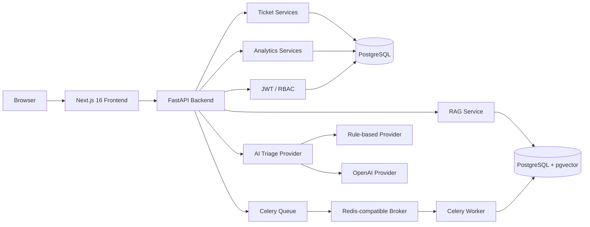

# Support Intelligence Platform

A production-style full-stack customer support platform combining ticket operations, role-based workflows, AI-assisted triage, retrieval-augmented support assistance, asynchronous knowledge indexing, human review, and operational analytics.

The project was built as a software engineering portfolio application with a focus on backend architecture, reliability, testing, asynchronous processing, AI integration patterns, and a modern TypeScript frontend.

---

## Live Demo

- **Live Application:** https://support-intelligence-platform-one.vercel.app
- **API Documentation:** https://support-intelligence-api-s5jr.onrender.com/docs
- **Source Code:** https://github.com/gepapant/support-intelligence-platform

The public demo is deployed with Next.js on Vercel and FastAPI/PostgreSQL on Render.

> The backend runs on free-tier infrastructure, so the first request after inactivity may require a cold start.

---

## Screenshots

### Ticket Workspace


### AI-Assisted Ticket Triage


### Analytics Dashboard


### Landing Page


---

## Overview

Support Intelligence Platform models a real customer-support workflow.

Support agents and administrators can manage tickets, assign work, move tickets through workflow states, analyze support requests, retrieve relevant internal knowledge, generate grounded reply suggestions, review AI-assisted responses, and monitor operational analytics.

The platform includes:

- Ticket creation and management
- Agent and admin roles
- JWT authentication
- Role-based access control
- Ticket assignment
- Ticket status workflows
- Filtering and pagination
- AI-assisted ticket triage
- Knowledge Base management
- Vector-based knowledge retrieval
- RAG-style reply assistance
- Human review and audit trail
- Asynchronous knowledge indexing
- Queue failure recovery
- Support analytics dashboard
- Backend and frontend CI

---

## Main Features

### Ticket Operations

Tickets support:

- priorities
- workflow status
- assignment to agents
- filtering
- pagination
- role-based editing
- access control

Workflow states:

```text
open → in_progress → closed
```

Administrators can assign tickets to agents, while agents can work with tickets assigned to them.

---

### Authentication and RBAC

The backend uses JWT-based authentication.

Supported roles:

```text
agent
admin
```

Role-based permissions protect administrative operations such as:

- user listing
- Knowledge Base management
- analytics
- ticket assignment

---

### AI-Assisted Ticket Triage

Tickets can be analyzed for:

- support category
- customer sentiment
- suggested priority
- concise summary

The triage layer uses a provider abstraction.

Development can run without external AI services using the built-in rule-based provider.

An OpenAI provider is also implemented using the Responses API and structured Pydantic output.

Example triage result:

```json
{
  "category": "billing",
  "sentiment": "negative",
  "suggested_priority": "high",
  "summary": "Customer reports being charged twice for the same order."
}
```

---

## Knowledge Base

Administrators can create and manage Knowledge Base articles.

Each article tracks its indexing lifecycle:

```text
queued
  ↓
indexing
  ↓
ready
```

Failures are explicitly stored:

```text
failed
```

Failed indexing jobs can be retried from the UI.

Article content changes automatically trigger re-indexing.

---

## Asynchronous Indexing

Knowledge indexing runs outside the HTTP request cycle using:

- Celery
- Redis-compatible queue
- background worker

This keeps API requests responsive while potentially expensive indexing work happens asynchronously.

The queue workflow is:

```text
Article create/update
        │
        ▼
   PostgreSQL
        │
        ▼
      Celery
        │
        ▼
 Redis-compatible queue
        │
        ▼
 Background worker
        │
        ▼
 Chunk + embed article
        │
        ▼
     pgvector
```

Queue failures are handled explicitly.

If the broker is unavailable after the article has already been persisted, the API does not incorrectly behave as though article creation itself failed.

Instead:

```text
article persisted
      ↓
dispatch failure
      ↓
indexing_status = failed
      ↓
user can retry
```

---

## Retrieval and RAG Workflow

Knowledge articles are split into searchable chunks and stored with vector representations.

The retrieval pipeline uses cosine similarity to find relevant Knowledge Base content for a support ticket.

```text
Ticket
  │
  ▼
Search query
  │
  ▼
Embedding
  │
  ▼
pgvector similarity search
  │
  ▼
Relevant knowledge chunks
  │
  ▼
Reply provider
  │
  ▼
Suggested response
```

The current development configuration uses:

```text
hash-embedding-dev-v2
```

for deterministic local embeddings and:

```text
template-rag-dev-v1
```

for deterministic reply generation.

These providers make the complete RAG workflow testable without requiring paid external AI APIs.

The architecture allows production embedding and LLM providers to replace these development implementations later.

---

## Human Review

Generated support replies are not automatically treated as final responses.

A support agent can:

```text
accept
edit
reject
```

a generated suggestion.

The platform stores the decision and final response, preserving a human-review audit trail.

This models a human-in-the-loop AI workflow instead of allowing autonomous AI output to directly become a customer response.

---

## Analytics Dashboard

Administrators have access to operational support analytics.

Current KPIs include:

- total tickets
- unassigned tickets
- AI-analyzed tickets
- high-priority active tickets
- negative-sentiment active tickets

The dashboard also includes distributions for:

- ticket status
- ticket priority
- AI category
- customer sentiment

Ticket creation trends are available for:

```text
7 days
30 days
```

Analytics are aggregated directly in SQL instead of loading all tickets into application memory.

The frontend visualizes analytics using Recharts.

---

## Architecture



---

## Technology Stack

### Backend

- Python 3.14
- FastAPI
- Pydantic v2
- SQLAlchemy 2
- Alembic
- PostgreSQL
- Psycopg 3
- pgvector
- Celery
- Redis-compatible queue
- PyJWT
- Argon2 password hashing
- OpenAI Python SDK
- Pytest
- Ruff
- uv

### Frontend

- Next.js 16
- React 19
- TypeScript
- Tailwind CSS
- Recharts
- Server Components
- Next.js Route Handlers

### Engineering

- Git
- GitHub
- GitHub Actions
- REST APIs
- async job processing
- repository/service architecture
- provider abstractions
- dependency injection
- automated testing
- CI pipelines

---

## Repository Structure

```text
support-intelligence-platform/
│
├── backend/
│   ├── app/
│   │   ├── api/
│   │   ├── core/
│   │   ├── db/
│   │   ├── domain/
│   │   ├── integrations/
│   │   ├── models/
│   │   ├── repositories/
│   │   ├── schemas/
│   │   ├── services/
│   │   └── worker/
│   │
│   ├── migrations/
│   ├── tests/
│   ├── .env.example
│   ├── pyproject.toml
│   └── uv.lock
│
├── frontend/
│   ├── src/
│   │   ├── app/
│   │   ├── components/
│   │   └── lib/
│   │
│   ├── .env.example
│   ├── package.json
│   └── package-lock.json
│
├── .github/
│   └── workflows/
│
└── README.md
```

---

# Local Development

## Prerequisites

Install:

- Python 3.14
- uv
- PostgreSQL
- Node.js
- npm
- Redis or another Redis-compatible server

On Windows, Memurai can be used as a Redis-compatible local broker.

---

## 1. Clone the repository

```bash
git clone https://github.com/gepapant/support-intelligence-platform.git

cd support-intelligence-platform
```

---

## 2. PostgreSQL

Create a PostgreSQL database and application user.

Example:

```sql
CREATE DATABASE support_intelligence;

CREATE USER support_app
WITH PASSWORD 'your-password';

GRANT ALL PRIVILEGES
ON DATABASE support_intelligence
TO support_app;
```

The project uses pgvector.

Before running the embedding migration on a new database, enable the extension:

```sql
CREATE EXTENSION vector;
```

---

## 3. Backend Environment

Move into the backend:

```bash
cd backend
```

Copy the example environment file:

```bash
cp .env.example .env
```

PowerShell:

```powershell
Copy-Item .env.example .env
```

Example configuration:

```env
DB_HOST=localhost
DB_PORT=5432
DB_NAME=support_intelligence
DB_USER=support_app
DB_PASSWORD=change-me

AUTH_SECRET_KEY=replace-with-a-random-secret-at-least-32-characters
AUTH_ALGORITHM=HS256
AUTH_ACCESS_TOKEN_EXPIRE_MINUTES=30

AI_PROVIDER=rule_based
AI_API_KEY=
AI_MODEL=gpt-6-luna

QUEUE_BROKER_URL=redis://localhost:6379/0
QUEUE_RESULT_BACKEND=redis://localhost:6379/1
```

Do not commit `.env`.

---

## 4. Install Backend Dependencies

```bash
uv sync
```

---

## 5. Run Database Migrations

```bash
uv run alembic upgrade head
```

---

## 6. Start FastAPI

```bash
uv run fastapi dev
```

The local API will normally be available at:

```text
http://127.0.0.1:8000
```

Interactive API documentation:

```text
http://127.0.0.1:8000/docs
```

---

## 7. Start the Queue Broker

Start Redis or your Redis-compatible server.

Local default:

```text
redis://localhost:6379
```

---

## 8. Start Celery

### Windows

```bash
uv run celery -A app.worker.celery_app:celery_app worker --loglevel=INFO --pool=solo
```

### Linux / production-style environments

```bash
uv run celery -A app.worker.celery_app:celery_app worker --loglevel=INFO
```

---

## 9. Frontend

Open another terminal:

```bash
cd frontend
```

Install dependencies:

```bash
npm install
```

Copy the environment configuration:

```bash
cp .env.example .env.local
```

PowerShell:

```powershell
Copy-Item .env.example .env.local
```

Local configuration:

```env
API_BASE_URL=http://127.0.0.1:8000
```

Start Next.js:

```bash
npm run dev
```

Frontend:

```text
http://localhost:3000
```

---

# Testing

## Backend

Run the complete backend suite:

```bash
cd backend

uv run pytest
```

Current suite:

```text
94 tests
```

Run linting:

```bash
uv run ruff check .
```

Run formatting:

```bash
uv run ruff format .
```

---

## Frontend

```bash
cd frontend

npm run lint
npm run build
```

---

# CI

GitHub Actions runs independent CI pipelines for both applications.

### Backend CI

Validates:

- Python dependencies
- Ruff
- backend tests

### Frontend CI

Validates:

- npm dependencies
- ESLint
- Next.js production build

This allows pull requests to be checked before merge.

---

# API Overview

Important endpoint groups include:

```text
/auth
/tickets
/knowledge
/admin
/analytics
```

Examples:

```text
POST   /auth/register
POST   /auth/login
GET    /auth/me

POST   /tickets
GET    /tickets
GET    /tickets/{id}
PATCH  /tickets/{id}
PATCH  /tickets/{id}/assignment
PATCH  /tickets/{id}/status

POST   /tickets/{id}/triage
POST   /tickets/{id}/suggested-reply

GET    /knowledge
POST   /knowledge
PATCH  /knowledge/{id}
POST   /knowledge/{id}/reindex

GET    /analytics/summary
GET    /analytics/trends?days=7
GET    /analytics/trends?days=30
```

---

# Production Deployment Architecture

A suitable deployment topology is:

```text
Vercel
  │
  └── Next.js frontend
          │
          ▼
Render Web Service
  │
  └── FastAPI
        │
        ├── PostgreSQL + pgvector
        │
        └── Redis-compatible queue
                │
                ▼
          Render Background Worker
                │
                └── Celery
```

Recommended separation:

### Frontend

```text
Vercel
Root Directory: frontend
```

Production environment variable:

```env
API_BASE_URL=https://your-backend.example.com
```

### Backend Web Service

```text
Render
Root Directory: backend
```

Build:

```bash
uv sync --frozen
```

Pre-deploy:

```bash
uv run alembic upgrade head
```

Start:

```bash
uv run fastapi run --host 0.0.0.0 --port $PORT
```

### Celery Worker

Use the same backend codebase and environment configuration.

Start command:

```bash
uv run celery -A app.worker.celery_app:celery_app worker --loglevel=INFO
```

### Queue

Use a Redis-compatible service.

The web service and worker must use the same broker URL.

```env
QUEUE_BROKER_URL=...
QUEUE_RESULT_BACKEND=...
```

### PostgreSQL

Enable pgvector once before applying migrations:

```sql
CREATE EXTENSION vector;
```

Then apply Alembic migrations.

---

# AI Configuration

The default local configuration is:

```env
AI_PROVIDER=rule_based
```

This requires no external API.

To use the implemented OpenAI triage provider:

```env
AI_PROVIDER=openai
AI_API_KEY=...
AI_MODEL=gpt-6-luna
```

API keys must only be configured through environment variables and must never be committed to the repository.

---

# Engineering Decisions

Several implementation choices were made deliberately.

### Service and Repository Layers

Database access is separated from business logic.

```text
API Route
   ↓
Service
   ↓
Repository
   ↓
Database
```

This makes the code easier to test and evolve.

### Provider Abstractions

AI-related integrations use provider abstractions.

This allows development implementations and external AI providers to be swapped without rewriting the business logic.

### Human-in-the-Loop AI

Generated replies require explicit human review instead of being sent automatically.

### Async Indexing

Knowledge indexing happens through a queue rather than blocking HTTP requests.

### Failure State Persistence

Queue failures are recorded in PostgreSQL so that the application can recover after infrastructure outages.

### SQL Analytics

Operational metrics are aggregated by PostgreSQL instead of retrieving all rows and calculating metrics in the frontend.

---

# Current Status

The project currently includes the complete portfolio MVP:

- authentication
- RBAC
- ticket workflow
- ticket assignment
- AI triage architecture
- Knowledge Base
- vector retrieval
- RAG assistance
- human review
- asynchronous indexing
- queue resilience
- analytics
- automated backend tests
- frontend production builds
- GitHub Actions CI

Development-mode AI and embedding providers remain intentionally available so the full application can run locally without paid external APIs.

Production-grade external embedding and generative reply providers can be added as future extensions.

---

# Future Improvements

Possible next steps include:

- production embedding provider
- production LLM reply-generation provider
- SLA and response-time metrics
- ticket search
- notifications
- audit log UI
- refresh-token authentication
- rate limiting
- observability and tracing
- structured production logging
- end-to-end browser testing

---

## Author

Built by [gepapant](https://github.com/gepapant) as a full-stack software engineering portfolio project.